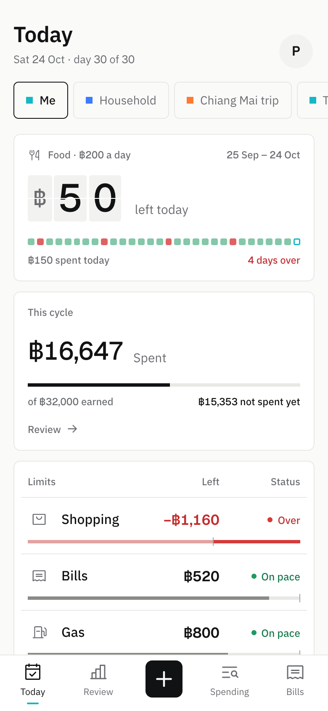
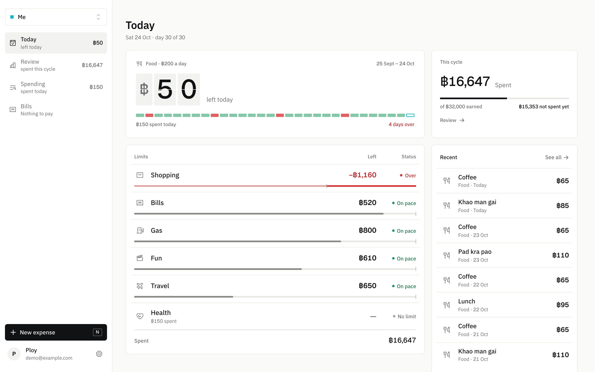
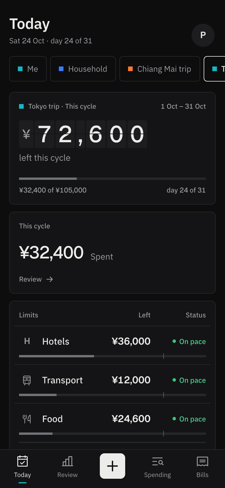
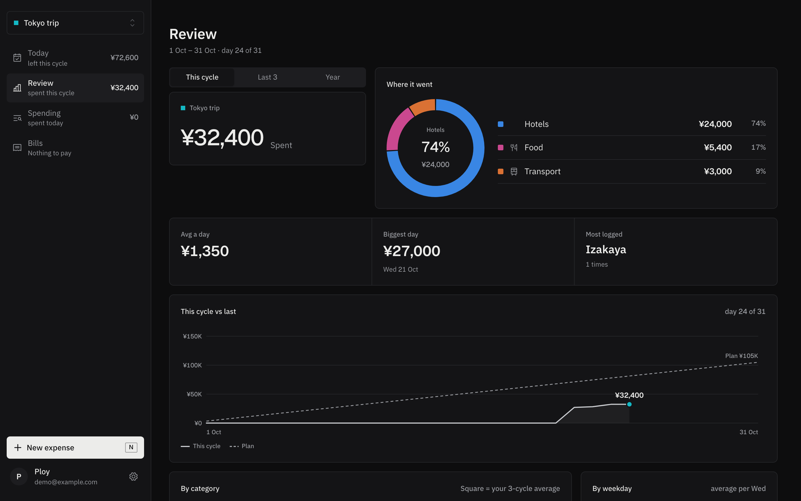

#  Pao

Pao is a self-hosted spending tracker for one household, whether that is a couple, housemates or one person. Members log spending by hand and always see what is left today and this cycle in each category.

- **Pockets.** Every member has a private personal pocket. Shared pockets let several members log into one budget, and each entry shows who logged it.
- **Limits.** Each category's limit is per day (strict: it resets every day) or per cycle. A cycle runs from the pocket's start day, such as payday, not from the 1st of the month.
- **A currency per pocket.** A baht home budget and a yen trip pocket can sit side by side. Pao never converts between currencies, and totals across pockets are shown once per currency.
- **Thai and English**, chosen by each member.
- **Runs at home.** One compose file pulls a prebuilt image for amd64 and arm64 (a Raspberry Pi with a 64-bit OS works). Phones can install it as an app.

Pao is a limit tracker, not a ledger: no bank sync, no imports, no balances. It is free under the MIT license, and support is best-effort (see [Support](#support)).

[Install](#install) · [Settings](#settings) · [Upgrade](#upgrade) · [Backups](#backups) · [Support](#support)

<p>
  <picture>
    <source media="(prefers-color-scheme: dark)" srcset="docs/screenshots/phone-dark-today.png">
    
  </picture>
  <picture>
    <source media="(prefers-color-scheme: dark)" srcset="docs/screenshots/desktop-dark-today.png">
    
  </picture>
</p>

<details>
<summary>More screenshots</summary>




</details>

<sub>Screenshots use the synthetic demo data from <code>scripts/seed-demo.ts</code>. They follow your GitHub theme.</sub>

## Install

You need a machine with Docker and the Compose plugin (`docker compose`). You don't need a `.env` file.

1. Make a folder for Pao and download the compose file into it:

   ```sh
   mkdir pao && cd pao
   curl -fsSLO https://raw.githubusercontent.com/nonpawite/pao/main/docker-compose.yml
   ```

2. Find the server's address on your network:

   ```sh
   hostname -I                # Linux
   ipconfig getifaddr en0     # macOS
   ```

3. Open `docker-compose.yml`. Under the `app` service's `environment`, set `DEFAULT_CURRENCY` and `APP_TZ`, for example:

   ```yaml
         DEFAULT_CURRENCY: EUR
         APP_TZ: Europe/Berlin
   ```

   [Settings](#settings) lists every option.

4. Start Pao:

   ```sh
   docker compose up -d
   ```

   On first start the app creates its auth secret, then sets up the database.

5. Open `http://<server address>:3000`, with the address from step 2, and create the first account. The first account is the **admin**. Setup then asks for your currency (starting on `DEFAULT_CURRENCY`), payday, categories and bank accounts, and makes your personal pocket. Do this before you share the address.

6. Invite the others: in **Settings → Members of this Pao**, type a name and choose **Invite**. Send the link, or read out the code. Each invite works once, for 7 days. Each member signs up with it and goes through their own Setup.

> [!WARNING]
> If you set `ALLOW_SIGNUP` to `"true"`, anyone who can open your instance can create an account, without an invite. If it is reachable from the internet, strangers can sign up. Keep it `"false"` before you expose Pao.

## Settings

Every setting lives in `docker-compose.yml`, under the `app` service. After you change one, run `docker compose up -d`.

| Setting | Shipped value | What it does |
| --- | --- | --- |
| `DEFAULT_CURRENCY` | `USD` | The currency Setup suggests for each new member's personal pocket, as an ISO 4217 code such as `THB`, `EUR` or `JPY`. A new shared pocket starts in its creator's personal-pocket currency. Any pocket can switch currency in its settings: its amounts are relabelled, never converted. Unset or unknown means `USD`. |
| `APP_TZ` | `UTC` | The household's time zone, as a [tz database name](https://en.wikipedia.org/wiki/List_of_tz_database_time_zones) such as `Europe/London`. "Today" and daily limits turn over at midnight there. Unset means `UTC`. |
| `ALLOW_SIGNUP` | `"false"` | `"false"`: sign-up by invite from the admin (the first account). `"true"`: anyone can sign up, and invites still work. Unset means `"false"`. |
| `BETTER_AUTH_URL` | not set | Needed only behind an HTTPS reverse proxy: the public address, such as `https://pao.example.com`. Sign-in cookies are then `Secure`, and sign-in from any other address is refused. Leave it unset at home. |
| Port | `3000` | The left number in `"3000:3000"` under the app's `ports`. |

The `db` service also publishes Postgres on the server's `127.0.0.1:5432`, for development. If another program on the server already uses port 5432, delete the `ports:` lines under `db`. The app doesn't need them.

### Database password

The database password is fixed (`tracker`). That is safe only because Postgres is reachable just from the app's container and from `127.0.0.1` on the server, never from other machines. If other people can log in to the server, change it.

<details>
<summary>Change the database password</summary>

```sh
docker compose exec db psql -U tracker -c "ALTER USER tracker PASSWORD 'new-password'"
```

Then put the same password in `POSTGRES_PASSWORD` and in `DATABASE_URL` in `docker-compose.yml`, and run `docker compose up -d`. Editing `POSTGRES_PASSWORD` alone does nothing to an existing database.

</details>

### HTTPS and access away from home

Pao serves plain `http`. Before members use it outside your home network, put it behind an HTTPS reverse proxy, such as Caddy, nginx or Traefik, that forwards to port 3000 on the server.

1. Keep sign-up by invite (`ALLOW_SIGNUP: "false"`, see the warning above).
2. Set `BETTER_AUTH_URL` to the public address, for example `https://pao.example.com`, and run `docker compose up -d`. Without it, sign-in behind the proxy is refused.

From then on, members sign in only at that address.

## Upgrade

The compose file uses `ghcr.io/nonpawite/pao:latest`. It follows the newest release, so an upgrade brings fixes and features, and a breaking release when the major version changes. Read the [release notes](https://github.com/nonpawite/pao/releases) first: they list any migration that rewrites data.

1. Back up the database:

   ```sh
   docker compose exec -T db pg_dump -U tracker tracker > pao-backup.sql
   ```

2. Pull the new image:

   ```sh
   docker compose pull
   ```

3. Restart:

   ```sh
   docker compose up -d
   ```

The app applies database migrations by itself when it starts.

To stay on major version 1, replace `:latest` with `:1`. To stay on one release, replace it with an exact version, for example `ghcr.io/nonpawite/pao:1.0.0`. To roll back, set the older version, [restore](#restore) the backup you made before the upgrade, and run `docker compose up -d`.

## Backups

Everything members log lives in Postgres, in the `db-data` volume. Make a backup in the Pao folder:

```sh
docker compose exec -T db pg_dump -U tracker tracker > pao-backup.sql
```

Keep copies somewhere other than the server. The `app-data` volume holds the auth secret. Losing it only signs everyone out.

> [!CAUTION]
> `docker compose down -v` deletes both volumes, and with them every entry, pocket and account.

### Restore

Restoring replaces everything in the database with the backup.

<details>
<summary>Restore from a backup</summary>

On a new server, do steps 1 to 4 of [Install](#install) first. Then, in the Pao folder, with `pao-backup.sql` in it:

```sh
docker compose stop app
docker compose exec db dropdb -U tracker tracker
docker compose exec db createdb -U tracker tracker
docker compose exec -T db psql -U tracker -d tracker -q -v ON_ERROR_STOP=1 < pao-backup.sql
docker compose start app
```

</details>

## Support

Pao is a hobby project with one maintainer. Support is best-effort, with no guaranteed response time.

- Bugs and feature ideas: [GitHub Issues](https://github.com/nonpawite/pao/issues).
- Security problems: report them privately, as [SECURITY.md](SECURITY.md) describes. They get priority.

## Contributing

Fixes, features and translations are welcome. [CONTRIBUTING.md](CONTRIBUTING.md) covers the development setup, the tests, how to add a language and what a pull request needs.

## License

MIT. See [LICENSE](LICENSE).
